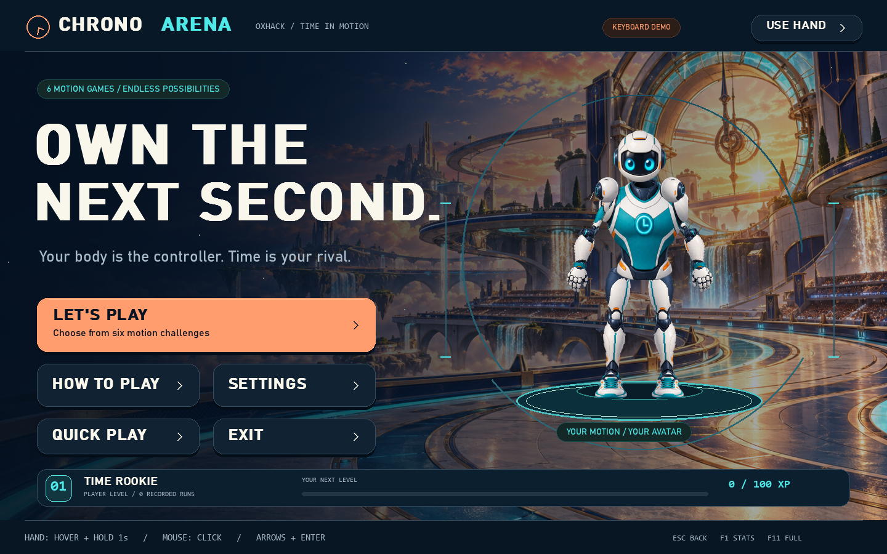
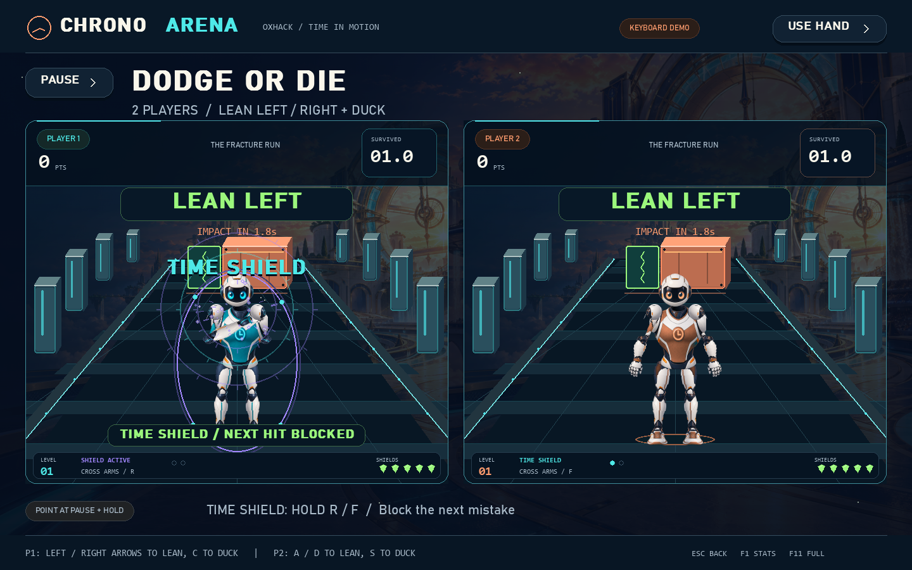
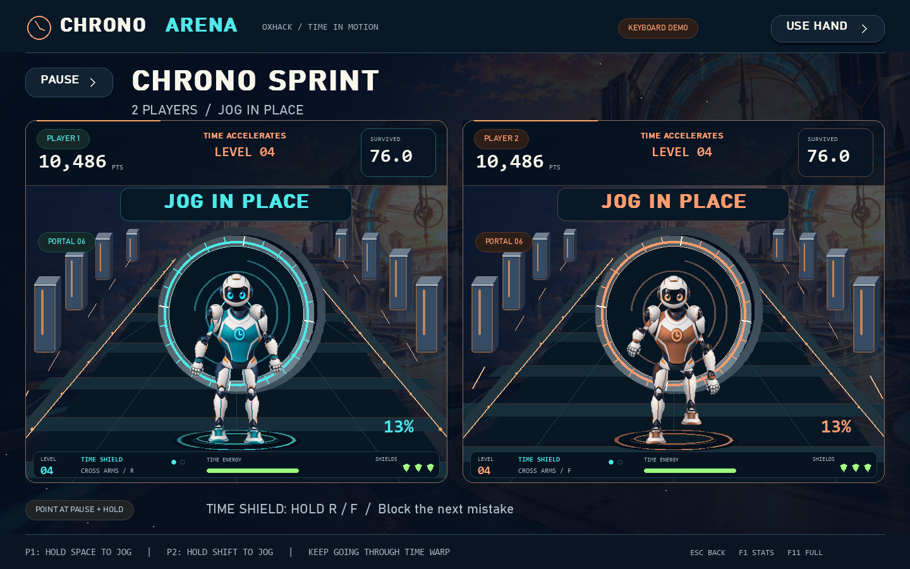

# CHRONO ARENA — Own the next second

Six motion-controlled sports challenges for **OxHack 2026 / TIME**. A webcam
becomes the controller: raise a hand to join, choose a game, and compete with
your timing, movement, memory and stillness.



## Run now

**Mac:** install Python 3.11, open Terminal in the extracted folder, run
`bash "Setup Mac.command"`, then `bash "Launch Mac.command"`.
For keyboard play: `bash "Launch Demo Mac.command"`.
Apple Silicon and Intel have separate compatible dependency selections.
See [START_HERE.md](START_HERE.md) for camera permissions and setup details.

Start with **[START_HERE.md](START_HERE.md)**. On the team's laptop, the existing
environment is ready. On a new Windows computer, extract the ZIP, install
64-bit Python 3.11, then double-click **Setup CHRONO ARENA.cmd** once. Both
tracking models and the artwork are bundled; setup needs internet for packages.

- Double-click **Launch CHRONO ARENA.cmd** for fullscreen webcam play.
- Double-click **Launch Demo.cmd** for a windowed keyboard/mouse simulation.

Or open PowerShell in this folder:

```powershell
.\.venv\Scripts\python.exe main.py
.\.venv\Scripts\python.exe main.py --demo --windowed
```

In webcam mode, stand back with your head, hands and feet visible. Keep arms
down for calibration, then hold either hand above your head for 1.2 seconds.
In demo mode, hold **H** to simulate that gesture, or press **Enter** to join
quickly. The complete flow is **LET'S PLAY → game → player mode → three rules →
START**. Move a hand over a button and hold for one second; move away after a
selection to rearm. Mouse clicks and arrows/Enter also work.

**USE HAND / USE MOUSE** is always in the top right. Settings lets you switch
between the webcam and keyboard demo without restarting. The bottom of each
game shows its relevant controls. Escape goes back or pauses a running match.

**QUICK PLAY** takes you straight to the Dodge or Die briefing in endless solo.
The gallery still offers all six games and four player modes.

**PRACTICE MOVES** on every briefing gives you a demonstration avatar and live
movement feedback before a run. Practice has no score, penalties, records or
XP. It is optional, works for one or two people, and you can start whenever ready.
The mirrored camera preview highlights visible joints and gives specific
head/feet/hands and lane-position guidance. Switching away from the game or
minimizing its window pauses an active match; returning never resumes it by itself.

## Presentation and gameplay upgrade

Each sport now has its own clockwork arena, raised track geometry, solid
obstacles or dimensional clock portal. Hits generate bounded sparks, clock
shockwaves and score pops. Clean dodges, rhythm hits and cleared portals have
different feedback. The soundtrack and 17 layered sound cues are synthesized
locally; no audio downloads or network services are needed.

**TIME SHIELD:** in endless survival, cross your wrists onto the opposite
shoulders and hold for 0.65 seconds. You can also hold **R** for Player 1 or
**F** for Player 2. One charge protects against the next mistake for five active
seconds. It blocks damage without awarding a fake hit or changing anyone else's
clock. Every run starts with one charge; a 12-hit chain earns another, up to two.
Release your arms/key before activating again. Timed challenge rules stay the
same. NOVA can use its own charge defensively.

Saved runs now earn local XP, player levels and rank titles. Camera and demo
progression are separate. Idle runs and banking before eight active seconds
earn no XP. Results show actual portals/hits, best chains and a performance
medal. Endless medals unlock at **20 / 45 / 90 / 180 seconds** with a positive
score; the next milestone is displayed clearly.

Movement and menu filters adapt to deliberate motion while smoothing small
noise. **Reduced Motion** in Settings disables decorative trails, flying
particles, pulses, score count-in and scene fades; gameplay timing and feedback
labels remain available.



## Six playable games

**Endless Survival is the default.** Each game continues beyond its old timer,
with a score, survival clock, shields and a level every 25 active seconds.
Portals start new laps; Echo Shift keeps creating sequences. The run ends when
shields run out, or when you pause and choose **BANK SCORE / RESULTS**. A short
finish announcement leads into results and a one-button rematch. Choose
**TIMED CHALLENGE** on the briefing to play the original finite rules below.

| Endless game | What gets harder | Fairness limits |
| --- | --- | --- |
| Red / Green | Shorter light cycles and higher energy drain | 0.5s stop grace; at most one shield lost per red light |
| Lightning Strike | Orbs expire sooner | Expiry never below 1.4s; hit radius and hold remain unchanged |
| Dodge or Die | Walls approach faster | Travel never below 1.6s; five shields |
| Chrono Sprint | Time energy drains faster | Steady jogging replenishes energy; portals add energy and points |
| Timekeeper | Beats accelerate and timing tightens | Period never below 1.8s; timing window never below 0.20s |
| Echo Shift | Longer sequences and quicker demonstrations | At most six poses; at least 0.8s per demonstration and 2s recall per pose |

Difficulty follows a smooth bounded curve rather than jumping in speed at level
boundaries. Twelve consecutive scored actions restore one missing shield.
Rendering stalls do not simulate unseen extra obstacles or drain seconds of
energy. Tracking loss freezes every active competitor's clock and difficulty.
Survival records are kept separate from timed records.



| Game | What you do | How TIME matters | Default challenge / record |
| --- | --- | --- | --- |
| **Red Light, Green Light** | Jog on green; freeze on red | Choose when to move and when to stop | Finish within 60s; fastest completion |
| **Lightning Strike** | Reach either hand onto an energy orb | Every target expires; chains reward quick follow-through | Score 1,200+ in 36s; highest score |
| **Dodge or Die** | Lean left/right or duck into the safe gap | Anticipate an approaching obstacle before impact | Survive 36s with five shields; highest score |
| **Chrono Sprint** | Jog in place and build speed | Race your previous time and exploit Time Warp windows | Finish within 40s; fastest completion |
| **Timekeeper** | Raise a hand as two rings meet; lower between beats | Synchronize with a repeating clock cycle | Score 650+ in 36s; highest score |
| **Echo Shift** | Watch, remember and repeat poses | Recreate the past, then beat your completion time | Complete 2-, 3-, and 4-pose sequences within 45s |

All six have a briefing, a distinct animated gameplay presentation, countdown,
feedback, outcome, rematch, records and timestamped events. There are no
disabled game placeholders.

Jogging requires alternating leg activity. Shaking one hand does not advance
the running games. On red, significant sustained body movement after a 0.5s
grace period costs seven percentage points of progress. Hysteresis and a
cooldown make ordinary camera jitter less likely to trigger repeated penalties.

Lightning targets require a brief hand hold. Dodge shows the required action
and impact countdown. Timekeeper produces an audio cue when the rings meet;
holding a hand up continuously cannot collect repeated beats. Echo Shift
demonstrates its sequence, hides it during recall, and replays it if recall
times out. Complete all three sequences to win.

## Four ways to play

Every game supports all four modes:

| Mode | Players | How it works |
| --- | --- | --- |
| **Solo** | 1 human | Beat the challenge and your personal best |
| **AI Rival** | 1 human + NOVA | Simultaneous competition against an offline opponent; Easy, Normal or Hard |
| **2 Players** | 2 humans simultaneously | Share one webcam; Player 1 stays in the left half of the mirrored image, Player 2 in the right |
| **Party / 2–4** | 2–4 humans taking turns | Choose the count on the briefing, calibrate each incoming player, and compare the same seeded challenge |

**NOVA** is a local rule-based AI with response delays, movement strength,
timing variation and mistakes. Difficulty changes those parameters. It uses
the same game engines, scoring, limits and seeded challenge patterns. No API
key, paid model call or internet connection is required for opponents.

In two-player mode, both people calibrate and raise a hand in the lobby. The
second player can arrive later; the first stays joined while waiting. Keep your
hips in your own camera lane. Hands can reach across the centre divider while
remaining inside the camera image. MediaPipe result ordering cannot exchange
the players' controls. Ambiguous overlapping bodies pause control until the
players separate, calibrate and raise a hand again. Avatars spawn centred on
their own platforms, even before calibration.
Player 1 normally drives shared menus; Player 2 can take over if Player 1 has
stepped out. Each competitor has an independent game and score, with clocks
paused together while an unfinished human is not reliably tracked.

If a competitor finishes first, the other continues. The finished competitor
can step out without pausing the remaining round. In endless AI mode, the run
ends when the human is eliminated, so NOVA cannot create an indefinite wait.
Party mode asks the next player to step into view and register afresh;
only the active player should be in view. The challenge seed is retained for
every turn. Party standings update after each turn and announce the winner
after everyone has played.

## Controls

| Action | Webcam | Demo Player 1 | Demo Player 2 |
| --- | --- | --- | --- |
| Join | Hold either hand above head | Hold H; Enter skips calibration | Hold T; Enter joins both in lobby |
| Menu selection | Point a hand; hold 1s | Mouse click, or arrows + Enter | Shared menus / remaining tracked player |
| Jog | Alternate knees in place | Hold Space | Hold Left Shift |
| Freeze | Stop moving | Release movement keys | Release movement keys |
| Lean | Lean left / right | Left / Right arrows | A / D |
| Duck | Crouch | C | S |
| Raise one hand / beat | Raise a hand | H | T |
| Both hands up / Echo | Raise both hands | U | W |
| Time Shield / endless | Cross arms and hold 0.65s, or R / F | Hold R | Hold F |
| Lightning hand aiming | Reach with either hand | Move mouse over the playfield | W/A/S/D move a hand cursor |

Global: **Escape** back/pause, **P** pause/resume, **F1** diagnostics,
**F2** restart in demo mode, **F3** hand control, **F11** fullscreen/windowed.
Hold **L** in demo to simulate lost tracking. A short interruption recovers;
long gaps require neutral calibration followed by a raised-hand join, directly
on the current screen. Point at **PAUSE** and hold to pause using your body;
point at **RESUME** to continue after a two-second ready countdown. Mouse drift
does not switch off webcam hand control. After an explicit mouse click, raise a
hand briefly in a menu or pause screen to restore gestures, or use **USE HAND**.
Keyboard/mouse selection uses click/Enter rather than dwell.

## Settings and camera positioning

Settings provides movement sensitivity, sound, mirrored preview visibility,
recalibration and webcam/demo switching. Changes save to `config.json`. The
file also exposes player name, camera index/resolution, FPS target, confidence,
smoothing, dwell, timing ranges, grace, movement hysteresis, penalty cooldown,
target radius/hold, beat period/window, lean/crouch thresholds and pose hold.

Default capture is 640×480 at a requested 30 FPS, with rendering capped at 60
FPS. Close other camera applications and enable Windows desktop-camera access
if needed. Change `camera_index` if the intended device is not camera 0.
For two players, move far enough back that both full bodies fit in separate
halves. Keep only the intended players in view. This is spatial continuity
tracking and requires visible bodies; similar people replacing one another at
the same position cannot be identified reliably.

On tracking loss, the game explains that time is on hold. All competitors'
clocks pause together. Return to your position for a short interruption. After
a long gap, stand still with arms down, then raise a hand to reconnect. The
same run and scores are preserved; a two-second ready countdown resumes it
automatically. No mouse is needed. Player 2 can drive menus if Player 1 leaves.
Settings recalibration ends the current round. A camera disconnect requires reconnecting/restarting capture or
switching to demo. Missing models and capture errors are shown in the UI.

## Installation on another computer

Verified on Windows with **64-bit Python 3.11.9**, MediaPipe **0.10.35**,
OpenCV **4.12.0**, NumPy **2.2.6**, and Pygame CE **2.5.8**. Pygame CE supplies
the `pygame` import; use a fresh environment rather than mixing distributions.

```powershell
py -3.11 -m venv .venv
.\.venv\Scripts\python.exe -m pip install -r requirements.txt
.\.venv\Scripts\python.exe scripts\download_models.py
.\.venv\Scripts\python.exe -m pip check
.\.venv\Scripts\python.exe main.py
```

Alternatively run `powershell -ExecutionPolicy Bypass -File .\setup.ps1`.
After setup, gameplay runs offline. Copy **assets/** with the project; its three
PNG files are part of the game. `models/manifest.json` records official model
URLs and checksums. The model bundles total approximately 14 MB.

On Linux/macOS, use `python3.11 -m venv .venv` and `.venv/bin/python` for these
commands. Those operating systems have not been validated here. Fonts fall
back to DejaVu Sans or Arial where Bahnschrift is unavailable.

## Presentation and artwork

The arena has an original clockwork stadium above the clouds, golden-hour
lighting, a six-card illustrated gallery, large prompts, smooth hover/scene
transitions, perspective tracks, animated obstacles, target effects, celebration
particles, original synthesized sound cues and a quiet synthesized music loop.
The music pauses during Timekeeper so its beat cue stays clear.

The avatar uses **3D-shaded textures in a joint-driven 2.5D sprite rig**: head,
torso, upper arms, forearms, gloves, thighs, shins, shoes and shoulder caps.
Live landmarks rotate and stretch independent parts; calibration normalizes
character size, and interpolation reduces jitter. Player 2 and NOVA use a warm
accent; the time echo is purple. A procedural character remains available if
the sprite asset is missing.

Artwork was made with the built-in image generation tool and copied into this
workspace. Full prompts, file names and generation details are in
[assets/PROMPTS.md](assets/PROMPTS.md). Source video assets were not copied.

## Architecture

```text
main.py                         CLI and application lifecycle
camera.py                       Latest-frame OpenCV capture thread
pose_tracker.py                 MediaPipe Tasks VIDEO worker, up to two poses
tracking_types.py               Mirrored landmarks, confidence, all-body output
player_manager.py               Neutral calibration, join, confidence, continuity
player_bank.py                  Fixed camera lanes and independent player inputs
gesture_controller.py           Cursor, distance-normalized hand switch, dwell latch
movement.py                     Alternating-leg activity and normalized motion
motion_input.py                 Shared movement vocabulary for humans and AI
simulated_input.py              Synthetic landmarks using the same tracking path
ai_opponent.py                  NOVA's offline decisions and difficulty
match.py                        Fair seeded games, shared pause and ranking
game_manager.py                 Navigation, input, multiplayer turns, persistence
games/                          Six independent game engines and common clock
avatar.py / sprite_rig.py        Animated poses and shaded texture rig
ui/art.py                       Artwork loading, caching and atlas slicing
ui/components.py                Buttons, game cards, mode cards and cursor
ui/screens.py                   Onboarding, gallery, briefings, lobby, results
ui/worlds.py                    Six animated gameplay presentations
audio.py                        Synthesized sound/music and stereo player cues
storage.py                      SQLite schema migration, records and boards
tests/                          Rules, camera, input, multiplayer and acceptance
scripts/                        Model setup, inference checks and benchmarks
```

MediaPipe uses the Tasks API with the official Pose Landmarker Lite and Hand
Landmarker bundles. OpenCV capture and inference have separate latest-result
threads. Rendering never waits for inference. Captured RGB coordinates are
mirrored once. Fine hand landmarks are associated by wrist proximity; body
wrists provide a fallback when fingers are small or occluded. The hand model is
skipped during games to prioritize body latency.

The game clocks use `time.perf_counter()`. The original running engine splits
intervals at light/grace/finish boundaries; arcade games integrate bounded
steps so impacts and beat windows cannot be skipped by a slower render frame.
Completion time is active play time, excluding the initial countdown and
tracking pauses. Timekeeper timing error is a score relative to the game beat.
These values do not establish precise human reaction times: capture, inference,
display and frame sampling introduce latency.

## Local records

`data/chrono_arena.sqlite3` stores completed human rounds. The upgrade migrates
the original results table in place and preserves existing Red/Green records.
Each entry includes UTC creation time, player, camera/demo source, game, match
mode, survival/timed variant, challenge seed, outcome, score, elapsed/remaining time, violations and
timestamped event JSON. Events cover phases, targets, misses, scoring, beats,
echo sequences, tracking pauses/resumes and outcomes.
Each new result also stores earned XP. Existing rows are preserved and start
with zero XP; player progression totals come from that player's saved results.

Records and personal bests are separated by game, source, match mode and
survival/timed variant. Existing records migrate as timed challenges. Time
games rank successful completion time; score games rank points. AI competitors
do not enter human leaderboards. Party turns store one entry per person.
Leaving for another game does not create a completed record; **BANK SCORE**
explicitly saves a survival run. Write failures are surfaced
in the interface.

## Automated verification

```powershell
.\.venv\Scripts\python.exe -m compileall -q -x .venv .
.\.venv\Scripts\python.exe -m pip check
.\.venv\Scripts\python.exe -m unittest discover -v
.\.venv\Scripts\python.exe main.py --smoke-test
.\.venv\Scripts\python.exe main.py --survival-test
.\.venv\Scripts\python.exe scripts\verify_tracking.py --camera
.\.venv\Scripts\python.exe scripts\benchmark.py --frames 300
.\.venv\Scripts\python.exe scripts\benchmark.py --mode duo --game sprint --frames 300
```

The smoke test uses temporary records/settings, deterministic seeds and actual
synthetic body landmarks. It joins by raising hands, navigates using wrist
positions plus smoothing/dwell, plays **all six games in all four modes**, tests
both 2- and 4-person parties, pauses/resumes, triggers a red penalty, rematches,
loses by timeout and validates personal-best preservation. Player 2 beats an
idle Player 1 in every game, and can navigate after Player 1 steps out. It
expects exactly **41 human result rows**, including the extra rematch. PNGs and
`acceptance-report.json` are under `artifacts/v2/`.

The survival test runs all six games in all four modes, including two turns per
party. Every human continues past 75 active seconds using 30 Hz synthetic body
landmarks through the real calibration, movement, lane assignment and smoothing
code. It verifies 36 human records, with reports/screenshots in
`artifacts/survival/`. Unit regressions cover staggered joins, hands crossing the
divider, disconnected players rejoining the same run, Player 2 taking menu
control, body-only pause/resume, stable off-centre avatar spawns, bounded
difficulty and three minutes of uninterrupted good play in every game.

`verify_tracking.py` checks one-body and two-hand official reference images,
negative blank input, and a two-body fixture made from the reference photograph.
With `--camera`, it checks physical webcam capture, worker inference and cleanup.
It does not save webcam images. The two-body fixture verifies multi-pose output;
it is separate from a real two-person playtest.

Verified in this Windows workspace on **24 October 2026**:

| Check | Observed result |
| --- | --- |
| Unit tests | 122 pass |
| Full body-input acceptance | All six games × Solo, AI, 2 Players and Party pass |
| Endless survival acceptance | All 24 combinations pass; 36 human runs continue past 75s |
| Join/reconnect regressions | Body-only late join, in-run recovery and P2 menu takeover pass |
| Party handoffs | 2- and 4-player sessions pass |
| Result integrity | One record per human finish; old schema migration passes |
| Physical webcam | Warmed probe: 90 captured and inferred frames in 3s, 24.45ms median inference; workers stop cleanly |
| Multi-pose reference fixture | Two bodies detected |
| Native solo render + synthetic input | ~6.5ms median, ~146 uncapped FPS |
| Native two-player render + synthetic input | Sprint: 8.71ms median / 13.72ms p95; sustained Lightning effects: 8.29ms / 13.73ms |
| Resource cleanup | Camera and inference workers stop cleanly |

These are local measurements; the rendering benchmarks measure simulated input
separately from camera inference. **Physical standing-player and two-person
gameplay still need a playtest** for room framing, occlusion, hand reach,
ordinary stillness, sensitivity and sound audibility. The webcam pipeline has
been exercised, while the complete movement/gameplay acceptance is synthetic.

## Demo route for judges

1. Launch the webcam game and join with a raised hand.
2. Open the gallery to show six distinct TIME mechanics and four player modes.
3. Play Red/Green for jogging/freezing, then Timekeeper for synchronization.
4. Try AI Rival in Chrono Sprint or Lightning Strike.
5. Use 2 Players for a side-by-side race, or Party for a shared-room tournament.
6. End on results: completion/score, personal best and the local standings.

## References

The optional live-movement practice and tracking viewer take design cues from
Microsoft's [Kinect interaction guidelines](https://download.microsoft.com/download/6/7/6/676611b4-1982-47a4-a42e-4cf84e1095a8/kinecthig.2.0.pdf)
and [Kinect Sports manual](https://download.microsoft.com/download/F/9/9/F99AB8F0-5191-4EDD-B312-7A9B9E4784FA/KinectSports_MNL_XD.pdf).
The demonstrations, artwork, audio and implementation in this project are its own.

The vision implementation follows Google's official
[Pose Landmarker guide](https://ai.google.dev/edge/mediapipe/solutions/vision/pose_landmarker/python)
and [Hand Landmarker guide](https://ai.google.dev/edge/mediapipe/solutions/vision/hand_landmarker/python).
Reference fixtures come from Google's
[pose sample](https://storage.googleapis.com/mediapipe-assets/pose.jpg) and
[Hand Landmarker notebook](https://github.com/google-ai-edge/mediapipe-samples/blob/main/examples/hand_landmarker/python/hand_landmarker.ipynb).
The user-provided [Kinect Sports video](https://www.youtube.com/watch?v=-AuBrN5up8k&t=68s)
set the presentation direction. Its metadata was retrieved; playback at the
requested timestamp was unavailable in this environment.

## Contributors

- [Abdelrahman Soliman](https://github.com/Abdelrahman-Eyad)
  — University of Essex, BSc Artificial Intelligence
- [Mphiwa Tema Mantswe](https://github.com/nothingwastakenSoCallMeT) - University of Manchester, MEng Mechatronic Engineering
- [Kesego Bogosi](https://github.com/Kesego-Bogosi) -University of Manchester,   BSc Computer Science
- Advik Ganesh Iyer - University of Manchester, MEng Mechatronics Engineering
